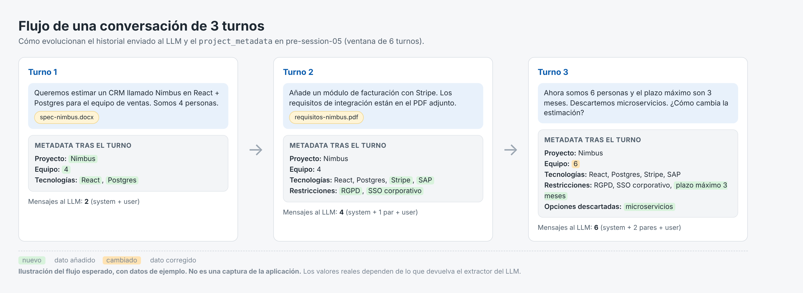
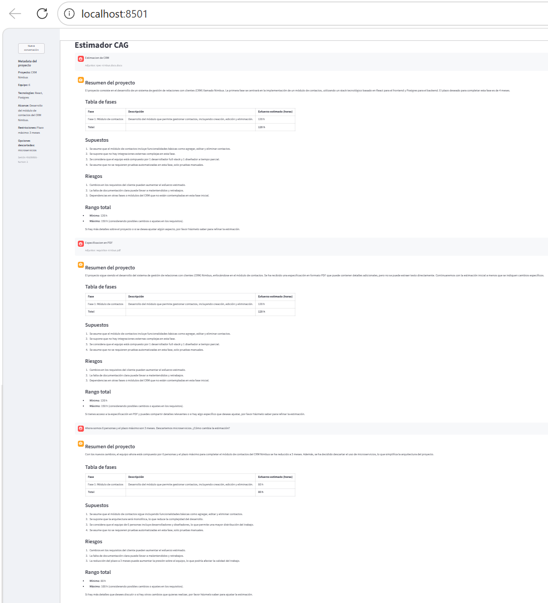

# Estimador CAG

Servicio que genera estimaciones de software a partir de transcripciones de reuniones, con arquitectura **CAG** (el contexto va inyectado en el prompt, sin base de datos ni retrieval).

En la sesión 5 se añade **memoria conversacional**: una sesión recuerda el proyecto entre turnos, acepta adjuntos PDF/Word y acumula los datos del proyecto (`project_metadata`), que el cliente Streamlit muestra en un panel. El endpoint transaccional `POST /api/v1/estimate` (sesión 4) se mantiene sin cambios.


Los documentos de `docs/` (`spec-nimbus.docx`, `requisitos-nimbus.pdf`) son ficticios, creados solo para la demo.

## Cómo se levanta

Requisitos: Python 3.11+, [uv](https://docs.astral.sh/uv/) y una API key de OpenAI. Desde la carpeta `estimador-cag`:

```powershell
uv sync
Copy-Item .env.example .env      # en Git Bash: cp .env.example .env
# Edita .env y completa OPENAI_API_KEY
```

Se necesitan dos terminales:

```powershell
uv run uvicorn app.main:app --reload      # API: http://localhost:8000 (Swagger en /docs)
uv run streamlit run streamlit_app.py     # cliente: http://localhost:8501
```

| Variable | Descripción | Por defecto |
|---|---|---|
| `OPENAI_API_KEY` | API key de OpenAI | (obligatoria) |
| `LLM_MODEL` | Modelo de la estimación y del extractor de metadata | `gpt-4o-mini` |
| `SESSION_MAX_TURNS` | Turnos (pares user+assistant) que conserva la ventana deslizante | `6` |
| `ESTIMATOR_API_BASE_URL` | URL de la API, usada por Streamlit | `http://localhost:8000` |

El cliente crea una sesión al cargar la página (`session_id` en `st.session_state`), permite enviar texto y varios archivos por turno, muestra el `project_metadata` en el panel lateral y tiene el botón **Nueva conversación**, que vuelve a llamar a `POST /sessions`.

## Probar una conversación de 3 turnos

Con la API y Streamlit levantados, escribe cada mensaje en el cuadro de texto, adjunta el archivo con el selector si corresponde, pulsa **Enviar** y espera unos segundos: cada turno hace dos llamadas al LLM.

### Los 3 turnos

| Turno | Mensaje | Adjuntos |
|---|---|---|
| 1 | Queremos estimar un CRM llamado Nimbus en React + Postgres para el equipo de ventas. Somos 4 personas. | `docs/spec-nimbus.docx` |
| 2 | Añade un módulo de facturación con Stripe. Los requisitos de integración están en el PDF adjunto. | `docs/requisitos-nimbus.pdf` |
| 3 | Ahora somos 6 personas y el plazo máximo son 3 meses. Descartemos microservicios. ¿Cómo cambia la estimación? | ninguno |

En el selector de archivos, navega hasta la carpeta `docs` del proyecto.

### Qué debe verse tras cada turno

| Turno | Panel lateral | Respuesta |
|---|---|---|
| 1 | Proyecto Nimbus, Equipo 4, Tecnologías React y Postgres. Puede añadir la fase 1 o el plazo del documento | Estimación del CRM |
| 2 | Lo anterior, más Stripe y SAP en tecnologías, y RGPD y SSO en restricciones | Incluye la facturación y la integración con SAP |
| 3 | Equipo 6, plazo máximo de 3 meses en restricciones, microservicios en descartadas | Sigue hablando de Nimbus, React, Postgres y Stripe sin que se repita, y no propone microservicios |



La redacción exacta del panel puede variar según el modelo. Lo importante es que los datos se acumulen, que el equipo cambie a 6 y que lo anterior no desaparezca.

### Comprobaciones finales

- **Historial:** bajo los mensajes de los turnos 1 y 2 aparece "Adjuntos: nombre del archivo".
- **Coherencia:** en el turno 3 no se repitió el nombre del proyecto y la respuesta aun así lo usa.
- **Nueva conversación:** el botón vacía el historial y el panel.

### La captura



### Si algo falla

| Síntoma | Qué mirar |
|---|---|
| Error "No se pudo crear la sesión" | La API no está levantada (terminal de uvicorn) |
| Error 502 | Clave de OpenAI o créditos; el detalle sale en la terminal de uvicorn |
| Error 422 con adjunto | Archivo que no es `.pdf`/`.docx`, o escaneado/corrupto; el mensaje lo indica |
| Panel vacío tras el turno 1 | Busca en la terminal de uvicorn el aviso "No se pudo actualizar la metadata" |
| "La sesión ya no existe" | Se reinició uvicorn: pulsa "Nueva conversación" |

## API

- `POST /api/v1/sessions` → `{"session_id": "<uuid4>"}`
- `POST /api/v1/sessions/{session_id}/estimate` — `multipart/form-data` con `transcript` (texto) y `attachments` (0..n `.pdf`/`.docx`). Devuelve `text`, `prompt_version`, `session_id`, `turns` y `project_metadata`. Errores: `404` sesión inexistente, `422` adjunto inválido o texto vacío, `502` fallo del LLM.

## Tests

```powershell
uv run pytest -v
```

Son offline: el LLM se sustituye por funciones falsas, sin gastar tokens. Los tres de integración del ejercicio usan `pytest` y `httpx.AsyncClient` (`tests/test_session_estimate_api.py`):

- `test_two_requests_update_project_metadata`: dos peticiones en la misma sesión actualizan la metadata y esta llega al system prompt del segundo turno.
- `test_pdf_attachment_content_reaches_the_prompt`: el texto de un PDF llega al prompt enviado al LLM.
- `test_eight_turns_never_exceed_max_turns`: con 8 turnos, el array enviado al LLM nunca supera `1 + 2·MAX_TURNS + 1` mensajes.

## Camino de adjuntos: B (extracción local)

El texto se extrae en el propio servicio con `pypdf` y `python-docx`, y se concatena al mensaje con separadores `--- attachment: nombre.pdf ---`, dentro de un bloque `<attachments>`. Elegí B y no subir el binario a la Files API (camino A) porque:

- no acopla el servicio a un proveedor con soporte de archivos: al modelo solo le llega texto;
- controla el coste: máximo 5 archivos por turno, 5 MB por archivo y 20 000 caracteres extraídos por archivo;
- permite defenderse del contenido: el adjunto es input del usuario, no instrucciones. El system prompt lo declara como datos y se sanean el nombre del archivo y las etiquetas de cierre.

Solo se admiten `.pdf` y `.docx`; un PDF escaneado (sin texto) no se lee. En el historial solo se guardan los **nombres** de los adjuntos: su texto viaja únicamente en el turno en que se suben, y los hechos relevantes los conserva el `project_metadata`.

## Cómo se extrae el `project_metadata`

`ProjectMetadata` vive aparte del historial y sobrevive al truncado de la ventana. Tiene seis campos: `project_name`, `assumed_team_size`, `mentioned_technologies`, `agreed_scope`, `explicit_constraints` y `rejected_options`. Se inyecta en el system prompt (plantilla v2) como bloque `<project_metadata>`, que se omite si está vacío.

Tras cada respuesta, una **segunda llamada al LLM** (`app/services/metadata_extractor.py`) recibe la ficha actual, el mensaje del usuario, los adjuntos y la respuesta del asistente, y devuelve la ficha completa actualizada en JSON. Se valida con Pydantic y se sanea (sin `<` ni `>`, longitudes y listas acotadas). Si algo falla, se conserva la metadata anterior y la conversación continúa.

Elegí un extractor con LLM y no una heurística porque los datos llegan en lenguaje natural ("somos cuatro", "mejor sin microservicios") y hay correcciones que las expresiones regulares no manejan bien. El coste es una llamada extra por turno. Como la metadata sale de texto del usuario y se reinyecta en el system prompt, el saneado evita una inyección persistente.

## Límites

- Las sesiones viven en un `dict` en memoria: se pierden al reiniciar el servidor. Es una decisión consciente para esta fase.
- La ventana deslizante descarta siempre pares completos (user+assistant); el system prompt se regenera en cada turno.

## Estructura

```
estimador-cag/
├── app/
│   ├── main.py, config.py, schemas.py
│   ├── sessions.py            # historial con ventana, ProjectMetadata, SessionStore
│   ├── dependencies.py        # almacén de sesiones compartido
│   ├── routers/               # estimations.py (sesión 4), sessions.py (sesión 5)
│   ├── services/              # llm_service.py, attachments.py, metadata_extractor.py
│   └── prompts/               # loaders y templates Jinja2 (v1 transaccional, v2 conversacional)
├── tests/
├── docs/
├── streamlit_app.py           # cliente conversacional
└── README.md
```
