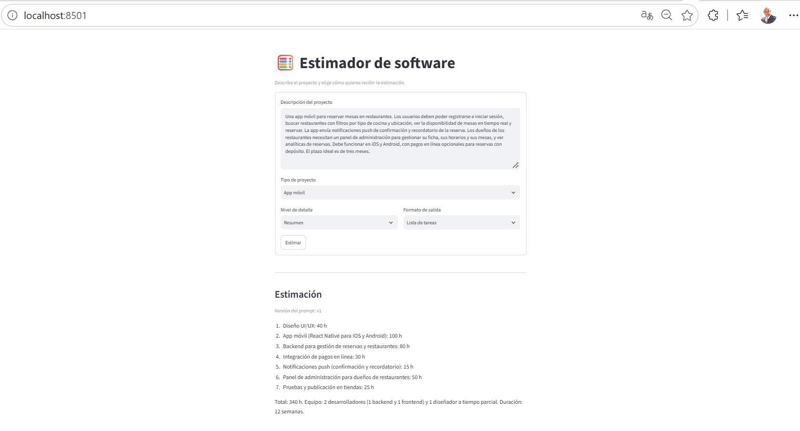

# Estimador CAG

Servicio que genera estimaciones de software a partir de la descripción de un proyecto, con arquitectura **CAG** (el contexto va inyectado en el prompt en cada llamada, sin base de datos ni retrieval).

El cliente es un **formulario** (Streamlit) que produce parámetros tipados. El servicio (FastAPI) construye el prompt a partir de **templates Jinja2 versionados** y llama al LLM con mensajes `system` y `user` separados.

## Arquitectura

```
Formulario Streamlit ──POST /api/v1/estimate──▶ FastAPI ──▶ render_estimation_prompt() ──▶ LLM (OpenAI)
   (EstimationRequest)                           (router)     templates .j2 versionados
```

- **Formulario tipado:** el espacio de tareas es acotado (tipo de proyecto, nivel de detalle, formato de salida), así que se usan `Enum` en lugar de un textarea libre.
- **Prompts fuera del código:** viven en `app/prompts/estimation/<versión>/` y se renderizan con Jinja2 (`StrictUndefined`, `trim_blocks`, `lstrip_blocks`).
- **Versionado:** cada versión del prompt es una carpeta (`v1/`, `v2/`...). La respuesta incluye `prompt_version` para saber qué prompt generó cada texto.

## Requisitos

- Python 3.11 o superior
- [uv](https://docs.astral.sh/uv/)
- API key de OpenAI con créditos

## Puesta en marcha

Todos los comandos se ejecutan desde la carpeta `estimador-cag`.

```powershell
uv sync
Copy-Item .env.example .env
# Edita .env y completa OPENAI_API_KEY
```

### Variables de entorno

| Variable | Descripción | Valor por defecto |
|---|---|---|
| `OPENAI_API_KEY` | API key de OpenAI | (obligatoria) |
| `ANTHROPIC_API_KEY` | Reservada para un proveedor futuro | vacía |
| `LLM_PROVIDER` | Proveedor del LLM (hoy solo `openai`) | `openai` |
| `LLM_MODEL` | Modelo a utilizar | `gpt-4o-mini` |
| `APP_ENV` | Entorno de ejecución | `development` |
| `LOG_LEVEL` | Nivel de logging | `DEBUG` |
| `ESTIMATOR_API_BASE_URL` | URL del servicio, usada por el formulario | `http://localhost:8000` |

## Ejecutar

Se necesitan **dos terminales**, ambas en `estimador-cag`.

**Terminal 1: servicio (FastAPI)**

```powershell
uv run uvicorn app.main:app --reload
```

- Swagger: http://localhost:8000/docs
- Health: http://localhost:8000/health

**Terminal 2: formulario (Streamlit)**

```powershell
uv run streamlit run streamlit_app.py
```

Abre http://localhost:8501, describe el proyecto, elige tipo, nivel de detalle y formato de salida, y pulsa **Estimar**.

## Vista previa



## API

### `POST /api/v1/estimate`

Request:

```json
{
  "description": "App móvil para reservar mesas en restaurantes, con pagos en línea.",
  "project_type": "mobile_app",
  "detail_level": "medium",
  "output_format": "phases_table"
}
```

| Campo | Valores |
|---|---|
| `description` | Texto de 20 a 2000 caracteres |
| `project_type` | `mobile_app`, `web_saas`, `internal_tool`, `data_pipeline` |
| `detail_level` | `summary`, `medium`, `detailed` |
| `output_format` | `phases_table`, `line_items`, `narrative` |

Response:

```json
{
  "text": "## Estimación ...",
  "prompt_version": "v1"
}
```

Prueba rápida con `curl.exe` (guarda el JSON anterior en `body.json`):

```powershell
curl.exe -X POST http://localhost:8000/api/v1/estimate -H "Content-Type: application/json" --data-binary "@body.json"
```

Un valor inválido en cualquier campo devuelve `422`. Si falla la llamada al LLM (key, créditos, etc.), el servicio devuelve `502` con el detalle.

## Prompts versionados

```
app/prompts/
├── loader.py                  # render_estimation_prompt(request, version="v1") -> (system, user)
└── estimation/
    └── v1/
        ├── system.j2          # rol, instrucciones, bloques por output_format y detail_level
        ├── user.j2            # envuelve la descripción en <project_description>
        └── examples.j2        # ejemplos few-shot (incluido desde system.j2)
```

Para crear una nueva versión, copia `v1/` como `v2/`, modifica los templates y llama al loader con `version="v2"`. El loader solo acepta nombres con el formato `v<número>`.

## Tests

```powershell
uv run pytest -v
```

- `tests/prompts/test_estimation_v1.py`: tests de los templates (contenido de la descripción, bloques condicionales por formato y nivel de detalle, versiones inválidas). Corren en milisegundos y **no llaman a ninguna API**. Verifican el template, no la calidad de la respuesta del modelo.
- `tests/test_api.py`: endpoint con el LLM simulado, validación del body.
- `tests/test_structure.py`: estructura de archivos del proyecto.

## Estructura del proyecto

```
estimador-cag/
├── app/
│   ├── main.py                # aplicación FastAPI y /health
│   ├── config.py              # configuración con pydantic-settings
│   ├── schemas.py             # enums y modelos Pydantic (request/response)
│   ├── routers/
│   │   └── estimations.py     # POST /api/v1/estimate
│   ├── services/
│   │   └── llm_service.py     # llamada al LLM (system y user separados)
│   └── prompts/               # loader y templates Jinja2 versionados
├── tests/
├── streamlit_app.py           # formulario
├── .env.example
├── pyproject.toml
└── README.md
```